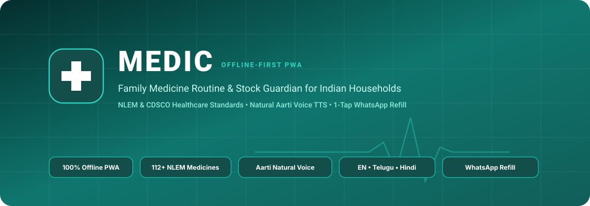
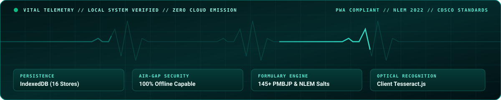

<div align="center">



<br/><br/>



<br/>

# MEDIC
### Offline-First Family Medicine Routine &amp; Inventory Guardian

[](https://razeltech.github.io/medic/)
[](https://razeltech.github.io/medic/)
[](https://cdsco.gov.in/)
[](#natural-accent-voice-assistance)
[](#zero-cloud-offline-architecture)
[](https://razeltech.github.io)

<p align="center">
  <strong>A resilient, 100% offline-first Progressive Web Application (PWA) tailored for multi-generational Indian households to track clinical routines, inventory stock depletion, optical packaging recognition, and pharmacy reorders with zero subscription fees, zero cloud surveillance, and authentic natural Indian accent voice guidance.</strong>
</p>

<p align="center">
  <a href="https://razeltech.github.io/medic/"><strong>[ Launch Web Application ]</strong></a> &nbsp;&bull;&nbsp;
  <a href="#clinical-system-overview"><strong>[ System Overview ]</strong></a> &nbsp;&bull;&nbsp;
  <a href="#core-capabilities"><strong>[ Core Capabilities ]</strong></a> &nbsp;&bull;&nbsp;
  <a href="#clinical-formulary-database"><strong>[ Medicine Catalogue ]</strong></a> &nbsp;&bull;&nbsp;
  <a href="#system-architecture"><strong>[ Architecture ]</strong></a> &nbsp;&bull;&nbsp;
  <a href="#local-development"><strong>[ Development ]</strong></a>
</p>

---

</div>

## Clinical System Overview

<table>
  <thead>
    <tr>
      <th align="left">System Metric</th>
      <th align="left">Clinical Specification</th>
    </tr>
  </thead>
  <tbody>
    <tr>
      <td><strong>Live Web Application</strong></td>
      <td><a href="https://razeltech.github.io/medic/">https://razeltech.github.io/medic/</a></td>
    </tr>
    <tr>
      <td><strong>Primary Repository</strong></td>
      <td><a href="https://github.com/razeltech/medic">https://github.com/razeltech/medic</a></td>
    </tr>
    <tr>
      <td><strong>Distribution Mirror</strong></td>
      <td><a href="https://github.com/r2dapps/medic">https://github.com/r2dapps/medic</a></td>
    </tr>
    <tr>
      <td><strong>Engineering Author</strong></td>
      <td><strong><a href="https://razeltech.github.io">Razel Tech</a></strong></td>
    </tr>
    <tr>
      <td><strong>Runtime Target</strong></td>
      <td>Modern Web Browsers (Chrome, Edge, Safari, Firefox), Android PWA, iOS PWA</td>
    </tr>
    <tr>
      <td><strong>Data Engine</strong></td>
      <td>100% Client-Side W3C IndexedDB (16 Object Stores, Zero Remote Transmission)</td>
    </tr>
    <tr>
      <td><strong>Clinical Standards</strong></td>
      <td>National List of Essential Medicines (NLEM 2022) &amp; CDSCO Formulations</td>
    </tr>
    <tr>
      <td><strong>Audio Synthesizer</strong></td>
      <td>Harmonic Web Audio Tri-Tone Chimes (D5-A5-D6) with Exponential Decay</td>
    </tr>
  </tbody>
</table>

---

## Core Capabilities

### 1. Zero-Cloud Offline Architecture
- Built strictly to W3C Progressive Web App standards with high-resilience Service Worker caching (`sw.js`).
- **Operating System Independence**: Runs identically on Android (standalone full-screen APK-like mode), Apple iOS (Safari home-screen mode), Windows, macOS, and Linux desktop browsers.
- Fully functional in air-gapped environments, rural healthcare settings, basements, or transit with zero cellular data requirement.

### 2. Clinical Intellisense &amp; NLEM Database
- Pre-loaded with **112+ essential medicine formulations** conforming to **NLEM 2022** and **CDSCO** guidelines across 13 clinical classifications:
  - **Type 2 Diabetes**: Glycomet 500/850/1000 SR, Glycomet-GP, Januvia, Galvus Met, Forxiga, Jardiance, Amaryl, Lantus.
  - **Hypertension &amp; Cardiology**: Telma 40/AM/H, Amlong, Cilacar, Starpress XL, Ecosprin 75/150, Atorva, Rosuvas, Concor, Losar.
  - **Gastric &amp; Acidity**: Pan 40, Pan-D, Omez, Razo, Pantocid, Digene, Gelusil.
  - **Analgesics &amp; Antipyretics**: Dolo 650, Calpol 500/650, Crocin, Combiflam, Zerodol-P/SP.
  - **Thyroid Disorders**: Thyronorm (25/50/75/100 mcg), Eltroxin.
  - **Respiratory Care**: Asthalin Inhaler, Budecort, Foracort, Montair LC, Deriphyllin.
  - **Vitamins &amp; Neuro Care**: Becosules Z, Neurobion Forte, Shelcal 500, Evion 400.
  - **Antibiotic Regimens**: Augmentin 625 Duo, Azithral 500, Taxim-O, Cifran.
- **Three-Tier Fuzzy Search**: Real-time keyboard-accessible (`Up`, `Down`, `Enter`, `Escape`) query engine with substring and prefix matching.
- **Automated Clinical Population**: Instantly populates brand name, active chemical molecule, strength, dosage format, therapeutic classification, and medical food timing.

### 3. Automatic Condition-Based Prescribing
- Inspects a patient's pre-diagnosed clinical conditions (e.g., *Type 2 Diabetes, Primary Hypertension*).
- Form automatically highlights and pre-selects relevant condition chips to accelerate prescription entry without manual classification errors.

### 4. Natural Accent Voice Assistance
- Dedicated speech synthesis prioritization engine configured for natural Indian phonetics:
  - **Windows &amp; Edge**: Prioritizes `Microsoft Aarti Online (Natural)`, `Heera`, or `Neerja`.
  - **Apple Safari (iOS &amp; macOS)**: Prioritizes `Rishi`, `Sangeeta`, `Veena`, `Lekha`, or `Neel`.
  - **Google Chrome &amp; Android**: Prioritizes `Google English (India)`, `Google Hindi`, or `Google Telugu`.
- **Acoustic Calibration**: Normalized `0.88x` playback speed, `1.04` pitch multiplier, and structured pause breaks to ensure clear audibility for elderly household members.
- Multilingual translation support across **English**, **Telugu (తెలుగు)**, and **Hindi (हिन्दी)**.

### 5. Harmonic Web Audio Acoustic Chimes
- Zero-external-file audio synthesizer built directly on the Web Audio API.
- Generates precise harmonic tri-tone reminders (D5: 587 Hz &rarr; A5: 880 Hz &rarr; D6: 1175 Hz) with natural exponential decay gain ramps, avoiding jarring alarm noise.
- Low-overhead background interval scheduler verifies pending doses every 15 seconds with haptic feedback integration.

### 6. WhatsApp Pharmacy Refill Dispatcher
- Compiles pending and depleted medicine orders into a standardized, clean message ready for instant transmission to local chemists and national pharmacies:
  ```text
  Namaste! Please deliver pharmacy medicine refill for Sharma Family:
  1. Glycomet 500 (Metformin 500 mg) - 2 Strips [Patient: Aditya Sharma]
  2. Telma 40 (Telmisartan 40 mg) - 2 Strips [Patient: Father]
  (Sent via MEDIC Health System)
  ```

### 7. Client-Side Tesseract.js Optical Character Recognition (OCR)
- Point camera or upload a photograph of any blister strip or prescription packaging.
- On-device HTML5 Canvas preprocessing applies grayscale normalization and threshold contrast filtering before passing data to client-side Tesseract.js OCR, extracting brand names and chemical compositions without uploading photographs to external servers.

### 8. Role-Based Access Control (RBAC)
- **CARETAKER**: Full administrative access. Prescribe schedules, register family members, scan blister packs, record purchases, and manage database backups.
- **ADULT**: Operational access. Mark taken doses, track personal routines, record expense purchases, and view schedules.
- **PATIENT (Senior Mode)**: Clean, high-contrast visual display. Mark doses taken, listen to voice instructions, and inspect remaining stock with destructive operations locked out.

---

## Clinical Formulary Database

<details open>
<summary><strong>NLEM 2022 &amp; CDSCO Formulary Classification Reference</strong></summary>
<br/>

<table>
  <thead>
    <tr>
      <th align="left">Clinical Classification</th>
      <th align="left">Reference Formulations</th>
      <th align="left">Standard Food Timing</th>
      <th align="left">Primary Regulatory Basis</th>
    </tr>
  </thead>
  <tbody>
    <tr>
      <td><strong>Cardiology &amp; BP</strong></td>
      <td>Telma 40, Telma AM, Amlong 5, Cilacar 10, Starpress XL 50</td>
      <td>After Food</td>
      <td>CDSCO / NLEM 2022</td>
    </tr>
    <tr>
      <td><strong>Endocrinology (Diabetes)</strong></td>
      <td>Glycomet 500, Glycomet-GP 1/2, Januvia 100, Galvus 50</td>
      <td>Before / With Food</td>
      <td>NLEM 2022</td>
    </tr>
    <tr>
      <td><strong>Gastroenterology</strong></td>
      <td>Pan 40, Pan-D, Omez 20, Pantocid 40, Gelusil</td>
      <td>Before Food (Empty Stomach)</td>
      <td>NLEM 2022</td>
    </tr>
    <tr>
      <td><strong>Analgesics &amp; Antipyretics</strong></td>
      <td>Dolo 650, Calpol 650, Combiflam, Zerodol-P</td>
      <td>After Food</td>
      <td>CDSCO / NLEM 2022</td>
    </tr>
    <tr>
      <td><strong>Thyroid Management</strong></td>
      <td>Thyronorm 25/50/75/100 mcg, Eltroxin</td>
      <td>Early Morning (Empty Stomach)</td>
      <td>CDSCO</td>
    </tr>
    <tr>
      <td><strong>Pulmonology (Asthma)</strong></td>
      <td>Asthalin 100 mcg Inhaler, Budecort, Montair LC</td>
      <td>Anytime / Night</td>
      <td>NLEM 2022</td>
    </tr>
    <tr>
      <td><strong>Nutritional Supplements</strong></td>
      <td>Becosules Z, Neurobion Forte, Shelcal 500, Evion 400</td>
      <td>After Food</td>
      <td>CDSCO</td>
    </tr>
    <tr>
      <td><strong>Infectious Diseases</strong></td>
      <td>Augmentin 625 Duo, Azithral 500, Taxim-O 200</td>
      <td>After Food</td>
      <td>CDSCO / NLEM 2022</td>
    </tr>
  </tbody>
</table>

</details>

---

## System Architecture

```text
+-------------------------------------------------------------------------+
|                           MEDIC CLIENT (PWA)                            |
+------------------------------------+------------------------------------+
| UI LAYER                           | LOGIC & ENGINES                    |
| - Semantic HTML5 Responsive Shell  | - Web Speech API (Indian Cadence)  |
| - Multilingual Dictionary Engine   | - Web Audio API (Harmonic Chimes)  |
| - Tailwind CSS Design Architecture | - 15-Second Due Dose Scheduler     |
| - Optical Strip Canvas OCR Preproc | - WhatsApp String Refill Builder   |
+------------------------------------+------------------------------------+
                                     |
                                     v
+-------------------------------------------------------------------------+
|                  W3C INDEXEDDB STORAGE (16 ATOMIC STORES)               |
+-------------------+--------------------+-------------------+------------+
| Households        | Caretakers         | FamilyMembers     | Conditions |
| MedicineCatalogue | MemberMedicines    | MedicineSchedules | DoseHistory|
| MedicineInventory | InventoryAdjustments| Purchases        | PurchaseItems|
| RefillHistory     | OCRRecords         | NotificationPrefs | AppSettings|
+-------------------+--------------------+-------------------+------------+
```

---

## Local Development

### 1. Clone Repository
```bash
git clone https://github.com/razeltech/medic.git
cd medic
```

### 2. Run Local Development Server
Because MEDIC is completely zero-backend and offline-first, no heavy build tools or runtime installations are mandated:
```bash
npx serve .
```
Or with Python:
```bash
python -m http.server 8000
```

### 3. Open Application
Navigate to `http://localhost:8000` or `http://localhost:3000` in any modern browser.

---

## License &amp; Mandatory Attribution

Copyright (c) 2026 **[Razel Tech](https://razeltech.github.io)**. All rights reserved.

Licensed under the **MIT License with Mandatory Author Attribution**. Any public deployment, mirror, or distribution must attribute the author as **Razel Tech** and include an active hyperlink to [https://razeltech.github.io](https://razeltech.github.io).
